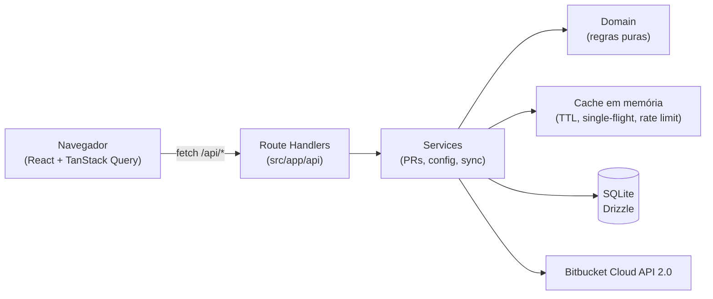
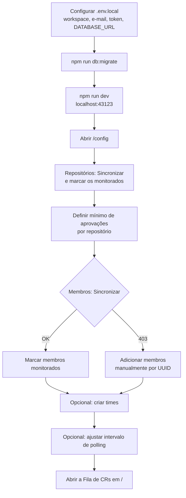
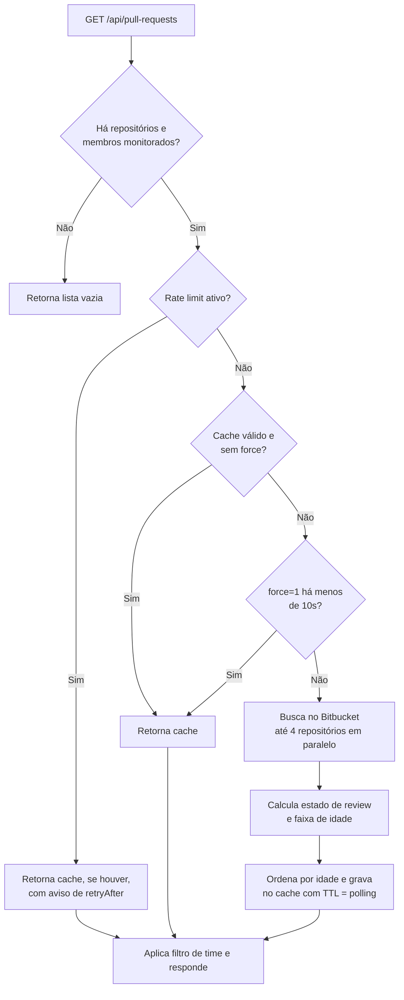

# CR Tracker — Visão geral do sistema

O **CR Tracker** é uma aplicação web **local** que centraliza os Pull Requests (code reviews) **abertos** no Bitbucket Cloud. Ele mostra uma fila única, ordenada do PR mais antigo para o mais novo, apenas com os PRs dos **membros** e **repositórios** que o usuário decidiu monitorar. O objetivo é responder rápido a perguntas como "quais PRs estão parados há mais de um dia?" e "o que já está aprovado e pronto para merge?".

Este documento descreve a arquitetura, as funcionalidades, os fluxos principais e o design de interface.

---

## 1. Stack e arquitetura

| Camada | Tecnologia |
| --- | --- |
| Framework | Next.js 16 (App Router) + React 19 |
| Dados no cliente | TanStack Query (cache, polling, mutações otimistas) |
| Tabelas | beUI Table (virtualizada com TanStack Virtual) |
| UI | beUI (componentes animados com Motion, em `components/motion`) + ReUI Filters e primitivos shadcn/ui (Base UI) restantes |
| Estilo | Tailwind CSS v4 com tokens em OKLCH |
| Banco | SQLite local via Drizzle ORM (`better-sqlite3`) |
| Validação | Zod (respostas do Bitbucket, payloads da API e respostas no cliente) |
| Testes | Vitest |

### Camadas do código

```
src/
├── app/            Rotas (páginas "/" e "/config") e Route Handlers em app/api/*
├── components/     UI: telas (pull-requests, config), shell (sidebar, header, ⌘K) e primitivos (motion = beUI, ui, reui)
├── hooks/          Hooks de dados (TanStack Query) e utilitários (useNow)
├── services/       Orquestração no servidor (PRs, configuração, sincronização)
├── domain/         Regras de negócio puras e testadas (estado de review, faixa de idade, filtro por time)
└── lib/            Cliente Bitbucket, cache em memória, contador de requests, banco e schema
```

O ponto central de segurança: **o token do Bitbucket nunca chega ao navegador**. Toda chamada ao Bitbucket passa pelos Route Handlers do Next.js, que usam autenticação HTTP Basic (`BITBUCKET_EMAIL` + `BITBUCKET_API_TOKEN`) lida das variáveis de ambiente.



---

## 2. Modelo de dados

O banco SQLite guarda a **configuração** do que monitorar, os PRs silenciados, as visões salvas, o tamanho dos PRs já calculado e o **histórico** da fila. A fila em si vem do Bitbucket e fica num cache em memória.

| Tabela | Conteúdo |
| --- | --- |
| `repositories` | Repositórios do workspace: `uuid`, `slug`, `name`, `monitored`, `min_approvals` (padrão 1), `sla_warning_hours` e `sla_critical_hours` (nulos = 24h/72h), `synced_at` |
| `members` | Membros: `uuid`, `nickname`, `display_name`, `avatar_url`, `monitored`, `source` (`workspace` ou `manual`) |
| `teams` | Times: `id`, `name` (único), `created_at` |
| `team_members` | Relação N:N entre times e membros (cascade on delete) |
| `team_repositories` | Relação N:N entre times e repositórios (cascade on delete) |
| `settings` | Linha única com `poll_interval_seconds` (30, 60 ou 120; padrão 30), `jira_base_url` e `jira_project_keys` |
| `snoozes` | PRs silenciados: `pr_key` (`{repoUuid}:{id}`), `reason`, `kind` (`24h`, `tomorrow`, `until_change`), `until_ms`, `until_updated_on` |
| `saved_views` | Visões salvas: `name` (único), `tab`, `team_id`, `filter_query` (JSON), `show_snoozed` |
| `pr_diffstats` | Linhas adicionadas/removidas e arquivos por PR, válidos enquanto `updated_on` não muda |
| `pr_history` | Linha do tempo de cada PR: `first_seen_at`, `first_review_at`, `approved_at`, `last_seen_at`, `closed_at` |
| `queue_snapshots` | Retrato horário da fila: total, acima da atenção, críticos, aprovados, aguardando, mudanças pedidas |

---

## 3. Funcionalidades

### 3.1 Fila de CRs (`/`)

É a tela principal. Mostra os PRs abertos nos **repositórios monitorados** cujo autor é um **membro monitorado**, mais os PRs em que o dono do token é revisor (mesmo de autores não monitorados).

- **Abas**:
  - **Todos**: a fila dos membros monitorados.
  - **Para mim**: PRs em que você é revisor e ainda não aprovou nem pediu mudanças. O contador da aba desconta os silenciados.
  - **Meus PRs**: os PRs abertos por você.
- **Indicadores no topo**: total no filtro atual, quantos passaram do SLA de atenção, quantos passaram do SLA crítico e quantos estão **prontos para merge** (aprovados, sem tarefas abertas e sem build falhando ou em andamento).
- **Tabela de PRs** com as colunas:
  - **Idade**: bolinha colorida + tempo relativo, e um selo com o limite real do repositório (ex.: `>12h`).
  - **Pull request**: título com link para o Bitbucket e, abaixo, `slug #id`, o selo do destino (`hotfix`, `prod` para master/main, `release`), a chave do Jira (link, se configurado), os contadores de comentários e de tarefas abertas (em âmbar quando um PR aprovado ainda tem tarefas) e o selo de silenciado com o motivo.
  - **Autor**, **Aprovações** e **Estado** (o "Aprovado" ganha o ícone do build).
  - **Tamanho**: P (até 50 linhas), M (até 250), G (até 1000) ou GG, calculado sob demanda pelo diffstat das linhas visíveis.
  - **Ações** (menu ⋯): ver detalhes, abrir no Bitbucket, silenciar/remover silêncio e "Me adicionar como revisor".
- **Ordenação padrão**: destinos prioritários primeiro (hotfix, depois master/main, depois release), e dentro de cada grupo do mais antigo para o mais novo. Clicar num cabeçalho ordena por aquela coluna; o terceiro clique volta à ordem padrão.
- **Painel de detalhes**: clicar na linha (ou Enter com ela focada) abre um painel lateral com branches, tamanho, aprovações, revisores e o estado de cada um, a descrição e os 5 últimos comentários, além das ações.
- **Silenciados** ficam fora da lista por padrão; "Mostrar silenciados" traz de volta, esmaecidos.
- **Filtro por time** (select "Todos os times" ou um time específico).
- **Filtros avançados** (ReUI Filters) por **repositório**, **autor**, **destino**, **tamanho** e **estado**, com operadores "é", "não é", "é qualquer de" e "não é nenhum de", combináveis com E/OU.
- **Visões salvas**: "Salvar visão" guarda aba, time, filtros e "mostrar silenciados" com um nome. A visão abre por `/?view=ID`, pela sidebar ou pelo ⌘K; se você mudar algo, aparece "Atualizar visão".
- **Rolagem virtualizada**: a tabela cresce até 14 linhas e, acima disso, rola internamente com o cabeçalho fixo.
- **Atualização automática** no intervalo configurado. Com a aba oculta, só a fila global segue sendo consultada (para badge e notificações), no mínimo a cada 120s.
- **Botão "Atualizar"** que força uma nova busca no Bitbucket (limitada a uma vez a cada 10 segundos no servidor).
- **Avisos contextuais**: configuração incompleta (nenhum repositório monitorado), limite de requisições do Bitbucket atingido (com contagem regressiva) e falhas por repositório (lista dos slugs e status HTTP).
- **Estados vazios** distintos para "nenhum repositório monitorado" (com botão para a Configuração), "nenhum PR neste filtro" e "fila zerada".

### 3.2 Regras de negócio dos PRs

Ficam em `src/domain/pull-request.ts` e são cobertas por testes unitários.

**Faixa de idade** (a partir da data de criação do PR). Os limites são configuráveis por repositório; o padrão é 24h e 72h:

| Faixa | Condição | Visual |
| --- | --- | --- |
| `normal` | antes do limite de atenção | bolinha cinza |
| `warning` | do limite de atenção ao crítico | bolinha amarela + selo `>Nh` |
| `critical` | depois do limite crítico | bolinha vermelha + selo `>Nh` |

**Outras regras** (também em `src/domain`, com testes):

- **Esperando minha revisão**: sou revisor, não sou o autor, não aprovei, não pedi mudanças e o PR não está silenciado.
- **Destino prioritário**: `hotfix/*`, depois `master`/`main`, depois `release/*`.
- **Chave do Jira**: regex `ABC-123`, procurada no título e depois na branch de origem; opcionalmente restrita aos projetos configurados.
- **Silêncio**: "por 24 horas", "até amanhã às 9h" (horário local do servidor) ou "até o PR mudar" (vence quando `updated_on` muda).
- **Carga de revisão**: por pessoa, PRs em que ela é revisora e não aprovou nem pediu mudanças.

**Estado de review**, avaliado nesta ordem de prioridade:

1. **Mudanças pedidas**: algum participante marcou "changes requested".
2. **Aprovado**: o número de aprovações atingiu o mínimo configurado para o repositório.
3. **Em revisão**: alguém além do autor já aprovou ou interagiu como revisor.
4. **Aguardando**: nenhuma atividade de review ainda.

Aprovações do próprio autor **não contam**.

**Escopo de um time**: um PR entra no filtro de um time quando o autor é membro do time **e** o repositório está no escopo do time. Se o time não tem repositórios selecionados, o escopo é "todos os repositórios monitorados".

### 3.3 Configuração (`/config`)

Organizada em abas: Repositórios, Membros, Times, Visões, Notificações, Integrações e Atualização. As abas de cadastro mostram no título a contagem do que está monitorado.

**Repositórios**
- Botão **Sincronizar** importa (ou atualiza) a lista de repositórios do workspace a partir do Bitbucket. A sincronização preserva o que já estava marcado como monitorado e o mínimo de aprovações.
- Tabela com checkbox **Monitorar**, nome e slug, campo **Mín. aprovações** (0 a 20) e os limites de SLA **Atenção (h)** e **Crítico (h)** (em branco = 24/72; a atenção precisa ser menor que o crítico). Os campos só editam repositórios monitorados, salvam ao sair do campo ou com Enter, e Esc descarta.
- Busca local por nome ou slug.

**Membros**
- Botão **Sincronizar** importa os membros do workspace.
- Se o token não tiver permissão para listar membros (HTTP 403), aparece um aviso e o usuário pode **adicionar manualmente** por UUID (com nickname opcional). Membros manuais já entram como monitorados e recebem o selo "Manual"; os importados recebem "Workspace".
- Tabela com checkbox **Monitorar**, avatar, nome, `@nickname` e UUID.
- Busca local por nome, nickname ou UUID.

**Times**
- Lista de times mostrando nome, membros, quantidade de membros e quantidade de repositórios (ou "Todos os repos").
- Botão **Novo time** e clique numa linha para editar, ambos abrindo um diálogo com nome, lista de membros monitorados (com as revisões pendentes de cada um e o selo "Menor carga") e lista de repositórios monitorados (vazio significa todos).
- Exclusão com confirmação dentro do próprio diálogo.

**Atualização**
- Escolha do intervalo de polling: **30s, 60s ou 120s**. O mesmo valor define o tempo de vida do cache no servidor.
- Contador de **requisições ao Bitbucket na última hora** (janela deslizante em memória, zerada quando o servidor reinicia).
- Indicador de **rate limit ativo** com o tempo até a próxima tentativa.

**Visões**
- Lista das visões salvas, com link, resumo (aba, time, quantidade de filtros), renomear e excluir.

**Notificações**
- Botão para pedir a permissão do navegador e interruptores por tipo de aviso (salvos no `localStorage`).
- Instruções para instalar o app e ter o badge na barra de tarefas.

**Integrações**
- URL do Jira e, opcionalmente, as chaves de projeto aceitas (ex.: `FUND, OPS`).

### 3.4 Contra o esquecimento

Um componente montado no layout (`AttentionSync`) acompanha a fila global em qualquer página:

- **Título da aba**: `(N) CR Tracker`, onde N é quantos PRs esperam a sua revisão.
- **Badge do app instalado**: o app é um PWA (`/manifest.webmanifest`, ícones gerados em `/icons/192` e `/icons/512`, service worker mínimo em `/sw.js`). Instalado pelo Chrome ou Edge, o ícone mostra N via `navigator.setAppBadge`.
- **Notificações do navegador**, só em transições e nunca repetidas:
  - pediram sua revisão;
  - um PR em que você é autor ou revisor passou do SLA crítico;
  - seu PR foi aprovado;
  - pediram mudanças no seu PR.

  O app guarda no `localStorage` o retrato anterior e os avisos já enviados; na primeira execução só registra o estado, sem disparar nada. O `tag` da notificação evita duplicatas entre abas, e clicar abre o PR.
- **Polling em segundo plano**: com a aba oculta (ou o app minimizado), a fila global continua sendo consultada, no mínimo a cada 120s, para o badge e as notificações não ficarem parados.
- **Silenciar com motivo** e **"Me adicionar como revisor"** ficam no menu de cada linha e no painel de detalhes. Adicionar revisor exige um token com **escopo de escrita em pull requests**; sem ele, o app explica o erro.

### 3.5 Equipe (`/equipe`)

- Tabela por membro monitorado com **Para revisar**, **Acima do SLA** (parte das pendentes que passou do limite de atenção) e **PRs abertos** como autor, ordenada por quem tem mais pendências.
- Selo **"Menor carga"** em quem tem menos pendências, para escolher um revisor.
- Filtro por time.

### 3.6 Histórico

Cada busca real no Bitbucket (não as respostas do cache) atualiza `pr_history`: quando o PR apareceu pela primeira vez, quando teve a primeira atividade de review, quando ficou aprovado e quando sumiu da fila (só conta como fechado se o repositório respondeu sem erro). No máximo uma vez por hora, grava um retrato agregado em `queue_snapshots`. Ainda não há tela para esses dados: eles existem para os futuros gráficos de tendência e de tempo até a primeira revisão.

### 3.7 Recursos globais

- **Status do token** no rodapé da sidebar: bolinha verde ("Token válido"), amarela ("Rate limit · Ns"), vermelha ("Token inválido") ou cinza ("Verificando token…"), e o total de requisições por hora. Atualiza a cada 10 segundos.
- **Paleta de comandos** (`⌘K` / `Ctrl+K`): navegar entre as telas, abrir visões salvas, recarregar a fila de PRs e trocar o tema.
- **Sidebar**: o item "Fila de CRs" mostra quantos PRs esperam a sua revisão, e o grupo "Visões" lista as visões salvas.
- **Atalhos de teclado** no estilo "G e depois letra": `G F` vai para a Fila de CRs, `G E` para a Equipe e `G C` para a Configuração. Os atalhos são ignorados enquanto o foco está num campo de texto.
- **Tema** escuro (padrão) ou claro pelo botão no header (com transição circular via View Transitions), ou também "do sistema" pela paleta.
- **Notificações (toasts)** no canto inferior direito para sucesso e erro de sincronizações e salvamentos.

---

## 4. Fluxos

### 4.1 Primeira configuração



### 4.2 Carregamento e atualização da fila

O cliente pede `GET /api/pull-requests?teamId=…` no intervalo configurado. O servidor decide entre devolver o cache ou consultar o Bitbucket:



Detalhes que tornam esse fluxo econômico em chamadas à API:

- **Uma chave de cache por conjunto de repositórios + membros monitorados**. O filtro de time é aplicado depois, sobre o resultado em cache, então trocar de time não gera novas chamadas ao Bitbucket.
- **Single-flight**: se várias abas pedem a mesma fila ao mesmo tempo, só uma busca real acontece.
- **Consulta filtrada no Bitbucket**: a busca já pede apenas `state="OPEN"` dos autores monitorados, em lotes de 25 UUIDs, com paginação limitada a 20 páginas e somente os campos necessários.
- **Retentativas**: erros 429 e 5xx são repetidos até 3 vezes com backoff exponencial (1s, 2s, 4s), respeitando o cabeçalho `Retry-After`. Cada chamada tem timeout de 10 segundos.
- **Falha parcial**: se um repositório falhar, os demais continuam e a UI lista quais falharam.
- **Invalidação**: qualquer alteração de configuração (monitorar, mínimo de aprovações, times, intervalo, sincronizações) limpa o cache, então a próxima busca já reflete a mudança.

### 4.3 Alterações na configuração

Marcar ou desmarcar um repositório ou membro, mudar o mínimo de aprovações e trocar o intervalo de polling usam **atualização otimista**: a interface muda na hora, a requisição vai ao servidor e, em caso de erro, o valor anterior é restaurado e um toast explica a falha. Ao final, a fila de PRs é invalidada para refletir a nova configuração.

### 4.4 Tratamento de rate limit

Quando o Bitbucket responde 429, o servidor registra até quando deve esperar. Nesse período, a fila é servida do cache e a UI mostra o aviso "Limite da API do Bitbucket atingido" com o tempo restante, tanto na fila quanto no rodapé da sidebar e na aba Atualização.

---

## 5. API interna

Todas as rotas ficam em `src/app/api` e respondem JSON. Erros seguem o formato `{ error: { code, message } }`.

| Método | Rota | Função |
| --- | --- | --- |
| GET | `/api/pull-requests?teamId=&force=` | Fila de PRs (com cache, filtro de time e refresh forçado) |
| GET | `/api/status` | Validade do token, requisições na última hora e rate limit |
| GET | `/api/config/repositories` | Lista repositórios |
| PATCH | `/api/config/repositories/[uuid]` | Altera `monitored`, `minApprovals`, `slaWarningHours` e/ou `slaCriticalHours` |
| GET / POST | `/api/config/members` | Lista membros / adiciona membro manual |
| PATCH / DELETE | `/api/config/members/[uuid]` | Altera `monitored` / remove membro |
| GET / POST | `/api/config/teams` | Lista / cria time |
| PUT / DELETE | `/api/config/teams/[id]` | Atualiza / exclui time |
| GET / PUT | `/api/config/settings` | Lê / altera intervalo de polling e integração com o Jira |
| GET / POST | `/api/config/views` | Lista / cria visão salva |
| PATCH / DELETE | `/api/config/views/[id]` | Renomeia ou atualiza / exclui visão |
| GET | `/api/me` | Dono do token (`uuid`, nome, avatar), buscado uma vez por credencial |
| GET | `/api/pull-requests/[repoUuid]/[id]` | Descrição e últimos comentários (cache por `updated_on`) |
| POST | `/api/pull-requests/[repoUuid]/[id]/reviewers/me` | Adiciona o dono do token como revisor (`missing_write_scope` em 401/403) |
| POST | `/api/pull-requests/insights` | Tamanho (diffstat persistido) e build (só aprovados) de até 50 PRs |
| PUT / DELETE | `/api/snoozes/[prKey]` | Silencia (`reason`, `kind`, `updatedOn`) / remove o silêncio |
| POST | `/api/bitbucket/repositories/sync` | Importa repositórios do workspace |
| POST | `/api/bitbucket/members/sync` | Importa membros do workspace (retorna `forbidden` em 403) |

---

## 6. Design de interface

### 6.1 Princípios

A interface segue a linha de **ferramenta de trabalho densa e silenciosa**, parecida com Linear ou Vercel: muita informação por tela, pouca decoração, e cor usada apenas para comunicar estado. O vermelho, o amarelo e o verde só aparecem quando há algo que merece atenção, como um PR crítico ou um número de aprovados maior que zero.

### 6.2 Estrutura de layout

```
┌────────────┬──────────────────────────────────────────────────────┐
│ [CR]       │ ☰ │ Workspace / Fila de CRs     [Buscar comandos ⌘K] ◐│  ← header fixo (48px)
│ CR Tracker │──────────────────────────────────────────────────────│
│            │  Fila de CRs                          Atualizado há… │
│ 🔍 Buscar  │  descrição                               [Atualizar] │
│            │                                                      │
│ WORKSPACE  │  ┌ Abertos ┬ >24h ┬ >72h ┬ Aprovados ┐                │  ← indicadores
│ ▸ Fila     │  └─────────┴──────┴──────┴───────────┘                │
│ ▸ Config.  │  [Time ▾] [Filtros…]                                 │
│            │  ┌──────────────────────────────────────────────┐    │  ← tabela virtualizada
│            │  │ Idade │ Pull request │ Autor │ Aprov. │ Estado│    │
│ ● Token ok │  └──────────────────────────────────────────────┘    │
└────────────┴──────────────────────────────────────────────────────┘
```

- **Sidebar** (beUI Animated Sidebar) recolhível para trilho de ícones (`⌘B`), estado salvo em cookie e transformada em gaveta no mobile. Contém a marca, o atalho de busca, a navegação e o status do token.
- **Header** fixo com botão da sidebar, breadcrumb ("Workspace / página atual"), busca de comandos e seletor de tema.
- **Conteúdo** centralizado com largura máxima de `max-w-7xl` e espaçamento interno de 16px no mobile e 32px no desktop.
- Cada página começa com um **PageHeader** padrão: título, descrição curta e ações alinhadas à direita.

### 6.3 Cores

Os tokens ficam em `src/app/globals.css`, definidos em **OKLCH** para os temas claro e escuro. A base é **neutra (cinza sem matiz)** e há um único tom de destaque azul-índigo (matiz 264).

| Token | Papel | Uso típico |
| --- | --- | --- |
| `primary` | Índigo | Ações principais, foco, logotipo, aprovações parciais |
| `success` | Verde | Estado "Aprovado", medidor completo, token válido |
| `warning` | Âmbar | PR acima de 24h, rate limit, aviso de 403 |
| `destructive` | Vermelho | PR acima de 72h, "Mudanças pedidas", erros, exclusões |
| `info` | Índigo | Estado "Em revisão" |
| `muted` / `secondary` | Cinzas | Textos secundários, estado "Aguardando", fundos de selos |

Cada cor semântica tem uma variante `-foreground` para texto, ajustada separadamente em cada tema para manter contraste. O tema **escuro é o padrão**.

### 6.4 Tipografia

- **Geist Sans** para a interface e **Geist Mono** para dados técnicos.
- A fonte mono com `tabular-nums` é usada de forma sistemática em números e identificadores: contadores, idades, `aprovadas/exigidas`, slugs, UUIDs, intervalos (`30s`) e atalhos. Isso mantém os números alinhados e evita que a tabela "pule" quando os valores mudam.
- Hierarquia enxuta: título de página `text-2xl` em negrito, textos de apoio `text-sm`/`text-xs` em `muted-foreground`.

### 6.5 Forma e espaçamento

- Raio base de **0,75rem**, com escala de `sm` (0,5rem) a `4xl` (2rem).
- Superfícies agrupadas como cartões com borda fina e fundo `card` (`rounded-2xl border bg-card`), sem sombras pesadas; botões, selos e campos em formato pílula (visual do beUI).
- Tabelas com bordas entre linhas e cabeçalho com fundo próprio, fixo no topo durante a rolagem.
- Movimento com molas do Motion (pressionar botões, indicador das abas, sidebar, modal, toasts), respeitando `prefers-reduced-motion`.
- Ícones Lucide em tamanho pequeno, sempre acompanhando um rótulo de texto nas ações.

### 6.6 Componentes visuais próprios

- **Indicador de idade**: bolinha de 8px cuja cor resume a faixa de idade, ao lado do tempo relativo.
- **Medidor de aprovações**: barra segmentada (um segmento por aprovação exigida). Os segmentos preenchidos ficam índigo enquanto o mínimo não é atingido e ficam todos verdes quando é.
- **Selos de estado**: `AnimatedBadge` do beUI com status semânticos (neutral, info, danger, success), com ícone e troca animada.
- **Faixa de indicadores**: grade de 2 colunas no mobile e 4 no desktop, separada por bordas internas, com esqueletos durante o carregamento.
- **Link do PR**: o título ganha cor primária ao passar o mouse e revela uma seta ↗ indicando que abre fora do app.

### 6.7 Estados e feedback

- **Carregamento**: esqueletos nos indicadores, na tabela e na lista de times; ícone de atualizar gira enquanto a requisição está em andamento.
- **Vazio**: componente `Empty` com ícone, título, explicação e, quando faz sentido, um botão de ação.
- **Erros e avisos**: `Alert` nas variantes `warning` e `destructive`, sempre com título curto e descrição acionável.
- **Ações**: toasts de sucesso com números ("12 repositórios sincronizados (3 novos, 9 atualizados)") e de erro com mensagem padrão em português.
- **Ações destrutivas**: excluir um time exige uma segunda confirmação no rodapé do diálogo.

### 6.8 Responsividade

- Sidebar vira gaveta no mobile e fecha automaticamente ao navegar.
- O botão de busca do header vira um ícone em telas pequenas.
- Barras de ferramentas e formulários empilham verticalmente no mobile e ficam em linha a partir de `sm`.
- O texto "Atualizado há… · a cada Ns" é escondido em telas pequenas para priorizar o botão de atualizar.

### 6.9 Acessibilidade

- Documento em `lang="pt-BR"` e toda a interface em português, incluindo os textos internos dos filtros. Alguns rótulos internos dos componentes beUI (como "Toggle sidebar" e "Close command palette") seguem em inglês.
- O medidor de aprovações usa `role="meter"` com `aria-valuenow`, `aria-valuemax` e um rótulo como "1 de 2 aprovações".
- O status do token é anunciado por leitores de tela (`role="status"` com `aria-live="polite"`).
- Checkboxes, campos numéricos e selects têm `aria-label` descritivo, como "Monitorar nome-do-repo".
- Datas usam `<time dateTime>` com a data absoluta no `title`.
- Foco visível com anel na cor `ring` em links, linhas clicáveis e controles.
- Ícones decorativos são ocultados com `aria-hidden`.

---

## 7. Observações e limites atuais

- O cache, o contador de requisições e o estado de rate limit vivem **em memória** no processo do servidor. Reiniciar o servidor zera tudo isso, mas não a configuração, que fica no SQLite.
- O app foi pensado para **uso local por uma pessoa**. Não há autenticação de usuários; quem acessa a porta `43123` tem acesso total à configuração.
- O endpoint `/api/status` consulta o Bitbucket (`/user`) a cada 10 segundos por aba aberta, sem cache. Isso entra na contagem de requisições por hora e pode ser relevante se houver muitas abas abertas.
- A trava de "Atualizar" (uma vez a cada 10 segundos) vale por conjunto de repositórios e membros monitorados, e não por time ou filtro.
- **Badge e notificações dependem do app aberto** (aba ou PWA, mesmo minimizado). Não há servidor de push: com o navegador fechado, nada é avisado.
- O **tamanho** custa uma chamada de diffstat por PR visível na primeira vez e de novo só quando o PR muda; o **build** custa uma chamada por PR aprovado visível a cada intervalo de polling.
- "Até amanhã às 9h" usa o fuso horário do processo do servidor, que no uso local é o da máquina.
- O snapshot da migração `0001` estava defasado, então `drizzle-kit generate` pede confirmações interativas; a `0002` foi escrita à mão.
