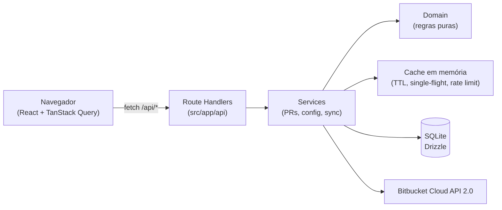
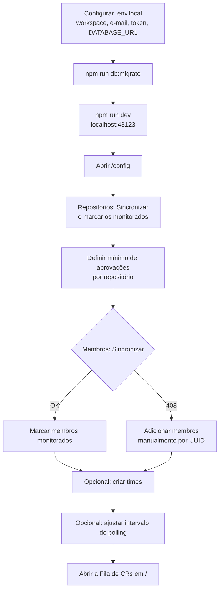
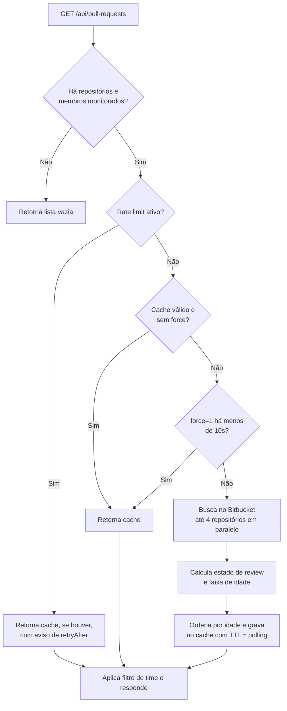

# CR Tracker — Visão geral do sistema

O **CR Tracker** é uma aplicação web **local** que centraliza os Pull Requests (code reviews) **abertos** no Bitbucket Cloud. Ele mostra uma fila única, ordenada do PR mais antigo para o mais novo, apenas com os PRs dos **membros** e **repositórios** que o usuário decidiu monitorar. O objetivo é responder rápido a perguntas como "quais PRs estão parados há mais de um dia?" e "o que já está aprovado e pronto para merge?".

Este documento descreve a arquitetura, as funcionalidades, os fluxos principais e o design de interface.

---

## 1. Stack e arquitetura

| Camada | Tecnologia |
| --- | --- |
| Framework | Next.js 16 (App Router) + React 19 |
| Dados no cliente | TanStack Query (cache, polling, mutações otimistas) |
| Tabelas | beUI Table (virtualizada com TanStack Virtual) |
| UI | beUI (componentes animados com Motion, em `components/motion`) + ReUI Filters e primitivos shadcn/ui (Base UI) restantes |
| Estilo | Tailwind CSS v4 com tokens em OKLCH |
| Banco | SQLite local via Drizzle ORM (`better-sqlite3`) |
| Validação | Zod (respostas do Bitbucket, payloads da API e respostas no cliente) |
| Testes | Vitest |

### Camadas do código

```
src/
├── app/            Rotas (páginas "/" e "/config") e Route Handlers em app/api/*
├── components/     UI: telas (pull-requests, config), shell (sidebar, header, ⌘K) e primitivos (motion = beUI, ui, reui)
├── hooks/          Hooks de dados (TanStack Query) e utilitários (useNow)
├── services/       Orquestração no servidor (PRs, configuração, sincronização)
├── domain/         Regras de negócio puras e testadas (estado de review, faixa de idade, filtro por time)
└── lib/            Cliente Bitbucket, cache em memória, contador de requests, banco e schema
```

O ponto central de segurança: **o token do Bitbucket nunca chega ao navegador**. Toda chamada ao Bitbucket passa pelos Route Handlers do Next.js, que usam autenticação HTTP Basic (`BITBUCKET_EMAIL` + `BITBUCKET_API_TOKEN`) lida das variáveis de ambiente.



---

## 2. Modelo de dados

O banco SQLite guarda a **configuração** do que monitorar, os PRs silenciados, as visões salvas, o tamanho dos PRs já calculado e o **histórico** da fila. A fila em si vem do Bitbucket e fica num cache em memória.

| Tabela | Conteúdo |
| --- | --- |
| `repositories` | Repositórios do workspace: `uuid`, `slug`, `name`, `monitored`, `min_approvals` (padrão 1), `sla_warning_hours` e `sla_critical_hours` (nulos = 24h/72h), `synced_at` |
| `members` | Membros: `uuid`, `nickname`, `display_name`, `avatar_url`, `monitored`, `source` (`workspace` ou `manual`) |
| `teams` | Times: `id`, `name` (único), `created_at` |
| `team_members` | Relação N:N entre times e membros (cascade on delete) |
| `team_repositories` | Relação N:N entre times e repositórios (cascade on delete) |
| `settings` | Linha única com `poll_interval_seconds` (30, 60 ou 120; padrão 30), `jira_base_url` e `jira_project_keys` |
| `snoozes` | PRs silenciados: `pr_key` (`{repoUuid}:{id}`), `reason`, `kind` (`24h`, `tomorrow`, `until_change`), `until_ms`, `until_updated_on` |
| `saved_views` | Visões salvas: `name` (único), `tab`, `team_id`, `filter_query` (JSON), `show_snoozed` |
| `pr_diffstats` | Linhas adicionadas/removidas e arquivos por PR, válidos enquanto `updated_on` não muda |
| `pr_history` | Linha do tempo de cada PR: `first_seen_at`, `first_review_at`, `approved_at`, `last_seen_at`, `closed_at`, além de título, link, autor, `changes_cycles` (quantas vezes entrou em "mudanças pedidas") e `review_tracked_from_start` (o app viu o PR antes da primeira revisão) |
| `team_rotations` | Escala de revisor do dia por time: `member_uuids` (ordem, JSON) e `start_date` (AAAA-MM-DD) |
| `focus_items` | Fila de foco: PR, `time_spent_ms`, `timer_started_at` (cronômetro rodando) e `done_at` (revisão concluída) |
| `queue_snapshots` | Retrato horário da fila: total, acima da atenção, críticos, aprovados, aguardando, mudanças pedidas |

---

## 3. Funcionalidades

### 3.1 Fila de CRs (`/`)

É a tela principal. Mostra os PRs abertos nos **repositórios monitorados** cujo autor é um **membro monitorado**, mais os PRs em que o dono do token é revisor (mesmo de autores não monitorados).

- **Abas**:
  - **Todos**: a fila dos membros monitorados.
  - **Para mim**: PRs em que você é revisor e ainda não aprovou nem pediu mudanças. O contador da aba desconta os silenciados.
  - **Meus PRs**: os PRs abertos por você.
- **Indicadores no topo**: total no filtro atual, quantos passaram do SLA de atenção, quantos passaram do SLA crítico e quantos estão **prontos para merge** (aprovados, sem tarefas abertas e sem build falhando ou em andamento).
- **Tabela de PRs** com as colunas:
  - **Idade**: bolinha colorida + tempo relativo, e um selo com o limite real do repositório (ex.: `>12h`).
  - **Pull request**: título com link para o Bitbucket e, abaixo, `slug #id`, o selo do destino (`hotfix`, `prod` para master/main, `release`), a chave do Jira (link, se configurado), os contadores de comentários e de tarefas abertas (em âmbar quando um PR aprovado ainda tem tarefas) e o selo de silenciado com o motivo.
  - **Autor**, **Aprovações** e **Estado** (o "Aprovado" ganha o ícone do build).
  - **Tamanho**: P (até 50 linhas), M (até 250), G (até 1000) ou GG, calculado sob demanda pelo diffstat das linhas visíveis.
  - **Ações** (menu ⋯): ver detalhes, abrir no Bitbucket, silenciar/remover silêncio e "Me adicionar como revisor".
- **Ordenação padrão**: destinos prioritários primeiro (hotfix, depois master/main, depois release), e dentro de cada grupo do mais antigo para o mais novo. Clicar num cabeçalho ordena por aquela coluna; o terceiro clique volta à ordem padrão.
- **Painel de detalhes**: clicar na linha (ou Enter com ela focada) abre um painel lateral com branches, tamanho, aprovações, revisores e o estado de cada um, a descrição e os 5 últimos comentários, além das ações.
- **Silenciados** ficam fora da lista por padrão; "Mostrar silenciados" traz de volta, esmaecidos.
- **Filtro por time** (select "Todos os times" ou um time específico).
- **Filtros avançados** (ReUI Filters) por **repositório**, **autor**, **destino**, **tamanho** e **estado**, com operadores "é", "não é", "é qualquer de" e "não é nenhum de", combináveis com E/OU.
- **Visões salvas**: "Salvar visão" guarda aba, time, filtros e "mostrar silenciados" com um nome. A visão abre por `/?view=ID`, pela sidebar ou pelo ⌘K; se você mudar algo, aparece "Atualizar visão".
- **Rolagem virtualizada**: a tabela cresce até 14 linhas e, acima disso, rola internamente com o cabeçalho fixo.
- **Visão de calendário**: o seletor **Lista / Calendário** (lembrado no `localStorage`) troca a tabela por um calendário mensal com os mesmos PRs da aba, time e filtros. Cada dia marca até 3 PRs abertos nele (pela data de criação), em vermelho ou âmbar quando passaram do SLA crítico ou de atenção; o cabeçalho conta os PRs do mês. Escolher um dia desliza o destaque até ele e troca a lista ao lado (título, `slug #id`, autor, idade, destino e estado), e clicar num PR abre o painel de detalhes. **Por projeto** também vale aqui: a lista do dia sai em blocos por projeto (e "Sem vínculo"), com a contagem e o "Editar" de cada bloco. Quando o dia tem mais de 10 PRs, a lista ganha paginação e **Por página** (10, 25, 50 ou 100, o mesmo valor da tabela); trocar de dia ou de agrupamento volta para a primeira página. Setas mudam o dia, Page Up/Page Down mudam o mês e **Hoje** volta para a data atual. As regras ficam em `src/components/pull-requests/queue-calendar-model.ts`, com testes.
- **Atualização automática** no intervalo configurado. Com a aba oculta, só a fila global segue sendo consultada (para badge e notificações), no mínimo a cada 120s.
- **Botão "Atualizar"** que força uma nova busca no Bitbucket (limitada a uma vez a cada 10 segundos no servidor).
- **Avisos contextuais**: configuração incompleta (nenhum repositório monitorado), limite de requisições do Bitbucket atingido (com contagem regressiva) e falhas por repositório (lista dos slugs e status HTTP).
- **Estados vazios** distintos para "nenhum repositório monitorado" (com botão para a Configuração), "nenhum PR neste filtro" e "fila zerada".

### 3.2 Regras de negócio dos PRs

Ficam em `src/domain/pull-request.ts` e são cobertas por testes unitários.

**Faixa de idade** (a partir da data de criação do PR). Os limites são configuráveis por repositório; o padrão é 24h e 72h:

| Faixa | Condição | Visual |
| --- | --- | --- |
| `normal` | antes do limite de atenção | bolinha cinza |
| `warning` | do limite de atenção ao crítico | bolinha amarela + selo `>Nh` |
| `critical` | depois do limite crítico | bolinha vermelha + selo `>Nh` |

**Outras regras** (também em `src/domain`, com testes):

- **Esperando minha revisão**: sou revisor, não sou o autor, não aprovei, não pedi mudanças e o PR não está silenciado.
- **Destino prioritário**: `hotfix/*`, depois `master`/`main`, depois `release/*`.
- **Chave do Jira**: regex `ABC-123`, procurada no título e depois na branch de origem; opcionalmente restrita aos projetos configurados.
- **Silêncio**: "por 24 horas", "até amanhã às 9h" (horário local do servidor) ou "até o PR mudar" (vence quando `updated_on` muda).
- **Carga de revisão**: por pessoa, PRs em que ela é revisora e não aprovou nem pediu mudanças.

**Estado de review**, avaliado nesta ordem de prioridade:

1. **Mudanças pedidas**: algum participante marcou "changes requested".
2. **Aprovado**: o número de aprovações atingiu o mínimo configurado para o repositório.
3. **Em revisão**: alguém além do autor já aprovou ou interagiu como revisor.
4. **Aguardando**: nenhuma atividade de review ainda.

Aprovações do próprio autor **não contam**.

**Escopo de um time**: um PR entra no filtro de um time quando o autor é membro do time **e** o repositório está no escopo do time. Se o time não tem repositórios selecionados, o escopo é "todos os repositórios monitorados".

### 3.3 Configuração (`/config`)

Organizada em abas: Repositórios, Membros, Times, Visões, Notificações, Integrações e Atualização. As abas de cadastro mostram no título a contagem do que está monitorado.

**Repositórios**
- Botão **Sincronizar** importa (ou atualiza) a lista de repositórios do workspace a partir do Bitbucket. A sincronização preserva o que já estava marcado como monitorado e o mínimo de aprovações.
- Tabela com checkbox **Monitorar**, nome e slug, campo **Mín. aprovações** (0 a 20) e os limites de SLA **Atenção (h)** e **Crítico (h)** (em branco = 24/72; a atenção precisa ser menor que o crítico). Os campos só editam repositórios monitorados, salvam ao sair do campo ou com Enter, e Esc descarta.
- Busca local por nome ou slug.

**Membros**
- Botão **Sincronizar** importa os membros do workspace.
- Se o token não tiver permissão para listar membros (HTTP 403), aparece um aviso e o usuário pode **adicionar manualmente** por UUID (com nickname opcional). Membros manuais já entram como monitorados e recebem o selo "Manual"; os importados recebem "Workspace".
- Tabela com checkbox **Monitorar**, avatar, nome, `@nickname` e UUID.
- Busca local por nome, nickname ou UUID.

**Times**
- Lista de times mostrando nome, membros, quantidade de membros e quantidade de repositórios (ou "Todos os repos").
- Botão **Novo time** e clique numa linha para editar, ambos abrindo um diálogo com nome, lista de membros monitorados (com as revisões pendentes de cada um e o selo "Menor carga") e lista de repositórios monitorados (vazio significa todos).
- Exclusão com confirmação dentro do próprio diálogo.

**Atualização**
- Escolha do intervalo de polling: **30s, 60s ou 120s**. O mesmo valor define o tempo de vida do cache no servidor.
- Contador de **requisições ao Bitbucket na última hora** (janela deslizante em memória, zerada quando o servidor reinicia).
- Indicador de **rate limit ativo** com o tempo até a próxima tentativa.

**Visões**
- Lista das visões salvas, com link, resumo (aba, time, quantidade de filtros), renomear e excluir.

**Notificações**
- Botão para pedir a permissão do navegador e interruptores por tipo de aviso (salvos no `localStorage`).
- Instruções para instalar o app e ter o badge na barra de tarefas.

**Integrações**
- URL do Jira e, opcionalmente, as chaves de projeto aceitas (ex.: `FUND, OPS`).

### 3.4 Contra o esquecimento

Um componente montado no layout (`AttentionSync`) acompanha a fila global em qualquer página:

- **Título da aba**: `(N) CR Tracker`, onde N é quantos PRs esperam a sua revisão.
- **Badge do app instalado**: o app é um PWA (`/manifest.webmanifest`, ícones gerados em `/icons/192` e `/icons/512`, service worker mínimo em `/sw.js`). Instalado pelo Chrome ou Edge, o ícone mostra N via `navigator.setAppBadge`.
- **Notificações do navegador**, só em transições e nunca repetidas:
  - pediram sua revisão;
  - um PR em que você é autor ou revisor passou do SLA crítico;
  - seu PR foi aprovado;
  - pediram mudanças no seu PR.

  O app guarda no `localStorage` o retrato anterior e os avisos já enviados; na primeira execução só registra o estado, sem disparar nada. O `tag` da notificação evita duplicatas entre abas, e clicar abre o PR.
- **Polling em segundo plano**: com a aba oculta (ou o app minimizado), a fila global continua sendo consultada, no mínimo a cada 120s, para o badge e as notificações não ficarem parados.
- **Silenciar com motivo** e **"Me adicionar como revisor"** ficam no menu de cada linha e no painel de detalhes. Adicionar revisor exige um token com **escopo de escrita em pull requests**; sem ele, o app explica o erro.

### 3.5 Equipe (`/equipe`)

- Tabela por membro monitorado com **Para revisar**, **Acima do SLA** (parte das pendentes que passou do limite de atenção) e **PRs abertos** como autor, ordenada por quem tem mais pendências.
- Selo **"Menor carga"** em quem tem menos pendências, para escolher um revisor, e **"Plantão hoje"** em quem está de plantão em algum time.
- Faixa com o revisor de plantão de cada time (veja 3.7).
- Filtro por time.
- **Relatório para a retro** (veja 3.9).

### 3.6 Histórico

Cada busca real no Bitbucket (não as respostas do cache) atualiza `pr_history`: quando o PR apareceu pela primeira vez, quando teve a primeira atividade de review, quando ficou aprovado, quantos ciclos de mudança teve e quando sumiu da fila (só conta como fechado se o repositório respondeu sem erro). No máximo uma vez por hora, grava um retrato agregado em `queue_snapshots`. O relatório semanal (3.9) e o Dashboard (3.11) são construídos sobre esses dados.

### 3.7 Escala de revisor do dia

- Configurada no diálogo de cada time: ativar, ordenar os membros (subir, descer, tirar, adicionar) e escolher o dia em que o primeiro da lista começa. A prévia mostra quem está de plantão hoje e no próximo dia útil.
- A escala anda **um passo por dia útil**. No fim de semana vale o plantão de sexta.
- O plantão aparece em destaque no topo da Fila de CRs (só o do time filtrado, quando há um) e na página Equipe.
- **PRs sem revisor** ganham o selo "Sugerido: Nome" com o plantão do time. O time é o primeiro com escala que contém o autor e cobre o repositório. Se o plantão for o próprio autor, sugere o próximo da escala. O painel de detalhes repete a sugestão.
- As regras ficam em `src/domain/rotation.ts`, com testes. A data é a do navegador.

### 3.8 Fila de foco

- No menu ⋯ da linha ou no painel de detalhes: **"Fixar no foco de hoje"**, até 3 PRs ao mesmo tempo.
- Na aba **Para mim**, a faixa "Foco de hoje" mostra os PRs escolhidos com um cronômetro. **Revisar** inicia, **Pausar** para e **Concluir** registra o tempo e libera a vaga. Só um cronômetro roda por vez: iniciar outro pausa o anterior.
- Os PRs do foco ficam fixados no topo da tabela de "Para mim", com um alfinete no título.
- Quando você já aprovou ou pediu mudanças, o cartão sugere concluir. Se o PR saiu da fila, o cartão avisa.
- O tempo fica no SQLite local (`focus_items`). Fechar a aba pausa o cronômetro (via `sendBeacon`). Tirar um PR do foco descarta o tempo dele.

### 3.9 Relatório semanal para a retro

- Na página Equipe, escolha a semana (de segunda a domingo, padrão: a semana passada) e use **Copiar Markdown** ou **Baixar .md**.
- O relatório traz:
  - PRs abertos na semana, que saíram da fila e que continuam abertos;
  - **mediana até a primeira revisão**, só com PRs que o app viu antes de serem revisados;
  - **PRs mais demorados** (que saíram da fila na semana) e os abertos há mais tempo;
  - **PRs com mais ciclos de mudança**;
  - o tempo registrado na fila de foco.
- As regras ficam em `src/domain/weekly-report.ts`, com testes.

### 3.10 Recursos globais

- **Status do token** no rodapé da sidebar: bolinha verde ("Token válido"), amarela ("Rate limit · Ns"), vermelha ("Token inválido") ou cinza ("Verificando token…"), e o total de requisições por hora. Atualiza a cada 10 segundos.
- **Paleta de comandos** (`⌘K` / `Ctrl+K`): navegar entre as telas do perfil, abrir visões salvas, recarregar a fila de PRs, mudar de perfil e trocar o tema.
- **Sidebar**: o item "Fila de CRs" mostra quantos PRs esperam a sua revisão, e o grupo "Visões" lista as visões salvas.
- **Atalhos de teclado** no estilo "G e depois letra": `G F` vai para a Fila de CRs, `G L` para o Painel do líder, `G D` para o Dashboard, `G E` para a Equipe e `G C` para a Configuração. Valem nos dois perfis. Os atalhos são ignorados enquanto o foco está num campo de texto.
- **Tema** escuro (padrão) ou claro pelo botão no header (com transição circular via View Transitions), ou também "do sistema" pela paleta.
- **Notificações (toasts)** no canto inferior direito para sucesso e erro de sincronizações e salvamentos.

### 3.11 Dashboard (`/dashboard`)

Tendências da fila nos últimos 30 dias (ou desde o início da gravação, se for mais recente), com filtro por time. Uma única seção mostra um gráfico por vez, escolhido nas abas Fila, Idade, Repositórios, Primeira revisão, Throughput, Carga por pessoa e Atividade; só o gráfico da aba ativa fica montado. Os gráficos usam os componentes do beUI quando há um adequado e o chart do shadcn (Recharts) para as séries temporais, que o beUI não tem.

| Gráfico | Componente | O que mostra |
| --- | --- | --- |
| Fila ao longo do tempo | Recharts (área empilhada) | PRs abertos no fim de cada dia: aguardando revisão, em revisão e aprovados |
| Distribuição por idade | beUI `composition-chart` | Parte da fila no prazo, em atenção e crítica, pelo SLA de cada repositório |
| PRs por repositório | beUI `composition-chart` | Os 4 repositórios com mais PRs abertos no período e o resto em "Outros" |
| Tempo até a primeira revisão | Recharts (linhas) | Mediana e percentil 75 por dia da revisão, só com PRs vistos antes de serem revisados |
| Throughput | Recharts (barras) | PRs abertos e concluídos (mergeados ou recusados) por dia |
| Carga de revisão por pessoa | beUI `bump-chart` | Posição de cada pessoa pelas revisões pendentes nos últimos 10 dias, contando os PRs abertos hoje pelo dia em que foram criados |
| Atividade de revisão | beUI `heat-calendar` | PRs que receberam a primeira revisão em cada dia, nas últimas 52 semanas |

- Todos os gráficos têm skeleton enquanto carregam, estado vazio, tooltip em pt-BR com `tabular-nums`, `aria-label` com um resumo em frase e o botão **Ver como tabela**, que troca o gráfico por uma tabela com os mesmos números.
- As séries saem de `pr_history` em `GET /api/dashboard` (regras em `src/domain/dashboard.ts`, com testes). A carga por pessoa vem da fila ao vivo, a mesma da página Equipe.
- Os componentes do beUI ficam em `src/components/charts/` e foram traduzidos para pt-BR. O calendário de atividade ancora o tooltip na grade (e não na célula) para posicioná-lo já no primeiro hover.

### 3.12 Perfis Dev e Líder

O app tem dois perfis que mudam a experiência, não as permissões:

- **Dev** (padrão): o menu fica como sempre, a home é a Fila de CRs e o item da fila mostra quantos PRs esperam a sua revisão.
- **Líder** (líder técnico ou PO): o menu começa pelo **Painel do líder** (`/lideranca`, atalho `G L`), seguido de Fila de CRs, Dashboard, Equipe e Configuração. A Bancada sai do menu, mas continua acessível pela URL e pelo atalho `G B`. A marca da sidebar leva ao Painel, e o item do Painel mostra em vermelho quantos PRs passaram do SLA crítico (fora os silenciados).
- A troca fica no rodapé da sidebar (segmentado "Dev | Líder"; no trilho recolhido, um ícone com tooltip) e no `⌘K` ("Mudar para perfil Líder/Dev"). Trocar leva para a home do perfil e mostra um toast.
- O perfil fica no cookie `cr_profile` (`dev` ou `lead`), lido pelo layout no servidor para o menu já vir certo no primeiro HTML.

### 3.13 Painel do líder (`/lideranca`)

Visão operacional para acompanhar times, projetos, PRs e o andamento de cada um, com o que pede ação primeiro. Usa a fila ao vivo (o mesmo cache da Fila de CRs, sem chamadas extras ao Bitbucket), o `pr_history`, os projetos e os times. Filtro de time e período (7, 14, 30 ou 90 dias) no cabeçalho; escolher um time na aba Times também filtra as outras abas. Atualiza no intervalo de polling configurado. Toda a interface usa componentes do beUI.

| Aba | O que mostra | Componentes |
| --- | --- | --- |
| Resumo | Indicadores (abertos, acima do SLA crítico, sem revisor, aprovados parados, entregues no período e ciclo mediano, com tendência e comparação com o período anterior); **Atenção agora** com os 10 PRs mais graves (o "Ver todos" abre a aba PRs filtrada pelos sinais de ação); saúde da fila pelo SLA; funil de entrega dos PRs abertos no período (abertos, revisados, aprovados e concluídos) | `Card`, `AnimatedNumber`, `Sparkline`, bloco `notification-stack`, `DonutChart`, `FunnelChart` |
| Times | Um card por time, do mais grave para o menos: saúde (Saudável, Atenção, Crítico), contagens, entregas por dia, ciclo mediano, plantão de hoje e as pessoas; histórico diário de saúde | `Card` selecionável, `AnimatedBadge`, `Sparkline`, `StatusBar`, `AvatarGroup` |
| Projetos | Projetos e features (ativos, concluídos ou todos) com % concluído, CRs em risco e flag **Parado**; ao expandir, estágios dos CRs, métricas, autores, a lista de CRs vinculados com riscos e a linha do tempo recente (aberto, 1ª revisão, aprovado, concluído) | `BouncyAccordion`, `AnimatedBadge`, `AvatarGroup`, `Timeline` |
| PRs | Todos os PRs abertos do escopo com time, autor, idade, estado, revisores e riscos, ordenados pelo risco; filtro por riscos e times; 25 por página; clicar abre o mesmo painel de detalhes da Fila, com as mesmas ações | `Table`, `MultiSelect`, `Pagination`, `Drawer` |
| Pessoas | Carga por pessoa (para revisar, atrasadas, PRs abertos e PRs próprios em risco), com plantão e menor carga; ranking de carga dos últimos dias | `Table`, `AnimatedBadge`, `bump-chart` |

**Sinais de risco por PR** (`src/domain/lead.ts`, com testes), do mais grave para o menos:

| Sinal | Gravidade | Quando dispara |
| --- | --- | --- |
| SLA crítico | Crítico | Passou do SLA crítico do repositório |
| Build falhou | Crítico | O último build conhecido do PR falhou |
| SLA em atenção | Atenção | Passou do SLA de atenção do repositório |
| Sem revisor | Atenção | Nenhum revisor indicado |
| Aprovado parado | Atenção | Aprovado há mais de 24h e ainda aberto |
| Idas e voltas | Atenção | 2 ou mais ciclos de pedido de mudança |
| Sem atividade | Atenção | Sem atualização há mais de 48h |
| PR muito grande | Informativo | Mais de 1000 linhas alteradas |

- "Atenção agora" e o contador da aba PRs consideram só os sinais críticos e de atenção, fora os PRs silenciados.
- **Saúde do time:** crítico com 2 ou mais PRs acima do SLA crítico; atenção com qualquer PR crítico ou com sinal de atenção; saudável no resto. O histórico diário usa só o SLA (é o que o `pr_history` permite reconstruir), e o dia de hoje usa o retrato ao vivo, com todos os sinais.
- **Projeto parado:** ativo, com CR aberto e sem atividade nos CRs há mais de 5 dias. O % concluído conta os CRs concluídos sobre os CRs com histórico gravado.
- Os limites ficam em `LEAD_LIMITS` e `CRITICAL_TEAM_THRESHOLD`, em `src/domain/lead.ts`.

---

## 4. Fluxos

### 4.1 Primeira configuração



### 4.2 Carregamento e atualização da fila

O cliente pede `GET /api/pull-requests?teamId=…` no intervalo configurado. O servidor decide entre devolver o cache ou consultar o Bitbucket:



Detalhes que tornam esse fluxo econômico em chamadas à API:

- **Uma chave de cache por conjunto de repositórios + membros monitorados**. O filtro de time é aplicado depois, sobre o resultado em cache, então trocar de time não gera novas chamadas ao Bitbucket.
- **Single-flight**: se várias abas pedem a mesma fila ao mesmo tempo, só uma busca real acontece.
- **Consulta filtrada no Bitbucket**: a busca já pede apenas `state="OPEN"` dos autores monitorados, em lotes de 25 UUIDs, com paginação limitada a 20 páginas e somente os campos necessários.
- **Retentativas**: erros 429 e 5xx são repetidos até 3 vezes com backoff exponencial (1s, 2s, 4s), respeitando o cabeçalho `Retry-After`. Cada chamada tem timeout de 10 segundos.
- **Falha parcial**: se um repositório falhar, os demais continuam e a UI lista quais falharam.
- **Invalidação**: qualquer alteração de configuração (monitorar, mínimo de aprovações, times, intervalo, sincronizações) limpa o cache, então a próxima busca já reflete a mudança.

### 4.3 Alterações na configuração

Marcar ou desmarcar um repositório ou membro, mudar o mínimo de aprovações e trocar o intervalo de polling usam **atualização otimista**: a interface muda na hora, a requisição vai ao servidor e, em caso de erro, o valor anterior é restaurado e um toast explica a falha. Ao final, a fila de PRs é invalidada para refletir a nova configuração.

### 4.4 Tratamento de rate limit

Quando o Bitbucket responde 429, o servidor registra até quando deve esperar. Nesse período, a fila é servida do cache e a UI mostra o aviso "Limite da API do Bitbucket atingido" com o tempo restante, tanto na fila quanto no rodapé da sidebar e na aba Atualização.

---

## 5. API interna

Todas as rotas ficam em `src/app/api` e respondem JSON. Erros seguem o formato `{ error: { code, message } }`.

| Método | Rota | Função |
| --- | --- | --- |
| GET | `/api/pull-requests?teamId=&force=` | Fila de PRs (com cache, filtro de time e refresh forçado) |
| GET | `/api/status` | Validade do token, requisições na última hora e rate limit |
| GET | `/api/config/repositories` | Lista repositórios |
| PATCH | `/api/config/repositories/[uuid]` | Altera `monitored`, `minApprovals`, `slaWarningHours` e/ou `slaCriticalHours` |
| GET / POST | `/api/config/members` | Lista membros / adiciona membro manual |
| PATCH / DELETE | `/api/config/members/[uuid]` | Altera `monitored` / remove membro |
| GET / POST | `/api/config/teams` | Lista / cria time |
| PUT / DELETE | `/api/config/teams/[id]` | Atualiza (inclusive a escala em `rotation`) / exclui time |
| GET / POST | `/api/focus` | Fila de foco ativa / fixa um PR (`FOCUS_FULL` acima de 3) |
| PATCH / DELETE | `/api/focus/[id]` | `start`, `pause` ou `complete` / tira do foco |
| POST | `/api/focus/pause-all` | Pausa todos os cronômetros (usado ao fechar a aba) |
| GET | `/api/reports/weekly?week=AAAA-MM-DD` | Relatório da semana que contém a data, em Markdown |
| GET | `/api/dashboard?teamId=&days=` | Séries diárias do Dashboard a partir de `pr_history`, com a comparação com a janela anterior (`days` em 7, 14, 30 ou 90) |
| GET | `/api/dashboard/teams?days=` | As mesmas séries por time, alinhadas nos mesmos dias, para comparar os times |
| GET | `/api/dashboard/features?teamId=&days=` | Projetos com o andamento dos CRs vinculados, entregas e fila aberta por tipo de trabalho |
| GET | `/api/lead?teamId=&days=` | Painel do líder: fila ao vivo com os sinais de risco, indicadores, funil, saúde de cada time, andamento dos projetos e carga por pessoa |
| GET / PUT | `/api/config/settings` | Lê / altera intervalo de polling e integração com o Jira |
| GET / POST | `/api/config/views` | Lista / cria visão salva |
| PATCH / DELETE | `/api/config/views/[id]` | Renomeia ou atualiza / exclui visão |
| GET | `/api/me` | Dono do token (`uuid`, nome, avatar), buscado uma vez por credencial |
| GET | `/api/pull-requests/[repoUuid]/[id]` | Descrição e últimos comentários (cache por `updated_on`) |
| POST | `/api/pull-requests/[repoUuid]/[id]/reviewers/me` | Adiciona o dono do token como revisor (`missing_write_scope` em 401/403) |
| POST | `/api/pull-requests/insights` | Tamanho (diffstat persistido) e build (só aprovados) de até 50 PRs |
| PUT / DELETE | `/api/snoozes/[prKey]` | Silencia (`reason`, `kind`, `updatedOn`) / remove o silêncio |
| POST | `/api/bitbucket/repositories/sync` | Importa repositórios do workspace |
| POST | `/api/bitbucket/members/sync` | Importa membros do workspace (retorna `forbidden` em 403) |

---

## 6. Design de interface

### 6.1 Princípios

A interface segue a linha de **ferramenta de trabalho densa e silenciosa**, parecida com Linear ou Vercel: muita informação por tela, pouca decoração, e cor usada apenas para comunicar estado. O vermelho, o amarelo e o verde só aparecem quando há algo que merece atenção, como um PR crítico ou um número de aprovados maior que zero.

### 6.2 Estrutura de layout

```
┌────────────┬──────────────────────────────────────────────────────┐
│ [CR]       │ ☰ │ Workspace / Fila de CRs     [Buscar comandos ⌘K] ◐│  ← header fixo (48px)
│ CR Tracker │──────────────────────────────────────────────────────│
│            │  Fila de CRs                          Atualizado há… │
│ 🔍 Buscar  │  descrição                               [Atualizar] │
│            │                                                      │
│ WORKSPACE  │  ┌ Abertos ┬ >24h ┬ >72h ┬ Aprovados ┐                │  ← indicadores
│ ▸ Fila     │  └─────────┴──────┴──────┴───────────┘                │
│ ▸ Config.  │  [Time ▾] [Filtros…]                                 │
│            │  ┌──────────────────────────────────────────────┐    │  ← tabela virtualizada
│            │  │ Idade │ Pull request │ Autor │ Aprov. │ Estado│    │
│ ● Token ok │  └──────────────────────────────────────────────┘    │
└────────────┴──────────────────────────────────────────────────────┘
```

- **Sidebar** (beUI Animated Sidebar) recolhível para trilho de ícones (`⌘B`), estado salvo em cookie e transformada em gaveta no mobile. Contém a marca, o atalho de busca, a navegação e o status do token.
- **Header** fixo com botão da sidebar, breadcrumb ("Workspace / página atual"), busca de comandos e seletor de tema.
- **Conteúdo** centralizado com largura máxima de `max-w-7xl` e espaçamento interno de 16px no mobile e 32px no desktop.
- Cada página começa com um **PageHeader** padrão: título, descrição curta e ações alinhadas à direita.

### 6.3 Cores

Os tokens ficam em `src/app/globals.css`, definidos em **OKLCH** para os temas claro e escuro. A base é **neutra (cinza sem matiz)** e há um único tom de destaque azul-índigo (matiz 264).

| Token | Papel | Uso típico |
| --- | --- | --- |
| `primary` | Índigo | Ações principais, foco, logotipo, aprovações parciais |
| `success` | Verde | Estado "Aprovado", medidor completo, token válido |
| `warning` | Âmbar | PR acima de 24h, rate limit, aviso de 403 |
| `destructive` | Vermelho | PR acima de 72h, "Mudanças pedidas", erros, exclusões |
| `info` | Índigo | Estado "Em revisão" |
| `muted` / `secondary` | Cinzas | Textos secundários, estado "Aguardando", fundos de selos |

Cada cor semântica tem uma variante `-foreground` para texto, ajustada separadamente em cada tema para manter contraste. O tema **escuro é o padrão**.

### 6.4 Tipografia

- **Geist Sans** para a interface e **Geist Mono** para dados técnicos.
- A fonte mono com `tabular-nums` é usada de forma sistemática em números e identificadores: contadores, idades, `aprovadas/exigidas`, slugs, UUIDs, intervalos (`30s`) e atalhos. Isso mantém os números alinhados e evita que a tabela "pule" quando os valores mudam.
- Hierarquia enxuta: título de página `text-2xl` em negrito, textos de apoio `text-sm`/`text-xs` em `muted-foreground`.

### 6.5 Forma e espaçamento

- Raio base de **0,75rem**, com escala de `sm` (0,5rem) a `4xl` (2rem).
- Superfícies agrupadas como cartões com borda fina e fundo `card` (`rounded-2xl border bg-card`), sem sombras pesadas; botões, selos e campos em formato pílula (visual do beUI).
- Tabelas com bordas entre linhas e cabeçalho com fundo próprio, fixo no topo durante a rolagem.
- Movimento com molas do Motion (pressionar botões, indicador das abas, sidebar, modal, toasts), respeitando `prefers-reduced-motion`.
- Ícones Lucide em tamanho pequeno, sempre acompanhando um rótulo de texto nas ações.

### 6.6 Componentes visuais próprios

- **Indicador de idade**: bolinha de 8px cuja cor resume a faixa de idade, ao lado do tempo relativo.
- **Medidor de aprovações**: barra segmentada (um segmento por aprovação exigida). Os segmentos preenchidos ficam índigo enquanto o mínimo não é atingido e ficam todos verdes quando é.
- **Selos de estado**: `AnimatedBadge` do beUI com status semânticos (neutral, info, danger, success), com ícone e troca animada.
- **Faixa de indicadores**: grade de 2 colunas no mobile e 4 no desktop, separada por bordas internas, com esqueletos durante o carregamento.
- **Link do PR**: o título ganha cor primária ao passar o mouse e revela uma seta ↗ indicando que abre fora do app.

### 6.7 Estados e feedback

- **Carregamento**: esqueletos nos indicadores, na tabela e na lista de times; ícone de atualizar gira enquanto a requisição está em andamento.
- **Vazio**: componente `Empty` com ícone, título, explicação e, quando faz sentido, um botão de ação.
- **Erros e avisos**: `Alert` nas variantes `warning` e `destructive`, sempre com título curto e descrição acionável.
- **Ações**: toasts de sucesso com números ("12 repositórios sincronizados (3 novos, 9 atualizados)") e de erro com mensagem padrão em português.
- **Ações destrutivas**: excluir um time exige uma segunda confirmação no rodapé do diálogo.

### 6.8 Responsividade

- Sidebar vira gaveta no mobile e fecha automaticamente ao navegar.
- O botão de busca do header vira um ícone em telas pequenas.
- Barras de ferramentas e formulários empilham verticalmente no mobile e ficam em linha a partir de `sm`.
- O texto "Atualizado há… · a cada Ns" é escondido em telas pequenas para priorizar o botão de atualizar.

### 6.9 Acessibilidade

- Documento em `lang="pt-BR"` e toda a interface em português, incluindo os textos internos dos filtros. Alguns rótulos internos dos componentes beUI (como "Toggle sidebar" e "Close command palette") seguem em inglês.
- O medidor de aprovações usa `role="meter"` com `aria-valuenow`, `aria-valuemax` e um rótulo como "1 de 2 aprovações".
- O status do token é anunciado por leitores de tela (`role="status"` com `aria-live="polite"`).
- Checkboxes, campos numéricos e selects têm `aria-label` descritivo, como "Monitorar nome-do-repo".
- Datas usam `<time dateTime>` com a data absoluta no `title`.
- Foco visível com anel na cor `ring` em links, linhas clicáveis e controles.
- Ícones decorativos são ocultados com `aria-hidden`.

---

## 7. Observações e limites atuais

- O cache, o contador de requisições e o estado de rate limit vivem **em memória** no processo do servidor. Reiniciar o servidor zera tudo isso, mas não a configuração, que fica no SQLite.
- O app foi pensado para **uso local por uma pessoa**. Não há autenticação de usuários; quem acessa a porta `43123` tem acesso total à configuração. O perfil Líder só muda o menu e a home, não restringe nada.
- No Painel do líder, **Build falhou** e **PR muito grande** só aparecem para PRs cujo build ou tamanho já foi consultado pela Fila de CRs ou pelo detalhe do PR; o Painel não faz essas chamadas sozinho.
- O endpoint `/api/status` consulta o Bitbucket (`/user`) a cada 10 segundos por aba aberta, sem cache. Isso entra na contagem de requisições por hora e pode ser relevante se houver muitas abas abertas.
- A trava de "Atualizar" (uma vez a cada 10 segundos) vale por conjunto de repositórios e membros monitorados, e não por time ou filtro.
- **Badge e notificações dependem do app aberto** (aba ou PWA, mesmo minimizado). Não há servidor de push: com o navegador fechado, nada é avisado.
- O **tamanho** custa uma chamada de diffstat por PR visível na primeira vez e de novo só quando o PR muda; o **build** custa uma chamada por PR aprovado visível a cada intervalo de polling.
- "Até amanhã às 9h" usa o fuso horário do processo do servidor, que no uso local é o da máquina.
- O snapshot da migração `0001` estava defasado, então `drizzle-kit generate` pede confirmações interativas; da `0002` em diante as migrações foram escritas à mão.
- Os tempos do relatório têm a precisão do polling: o app percebe a primeira revisão, os ciclos de mudança e a saída da fila na próxima atualização, e só enquanto está aberto. PRs que já tinham revisão quando o app os viu ficam fora da mediana.
- O histórico com título e ciclos de mudança começou a ser gravado com a migração `0004`; semanas anteriores aparecem sem esses dados.
- O Dashboard só enxerga o que o app viu: PRs abertos e fechados enquanto ele estava fechado não entram, e os dias antes do início da gravação não aparecem. A "Carga de revisão por pessoa" reconstrói o passado a partir da fila atual (quem revisa hoje e quando cada PR foi criado), então não mostra revisões que já foram feitas.
