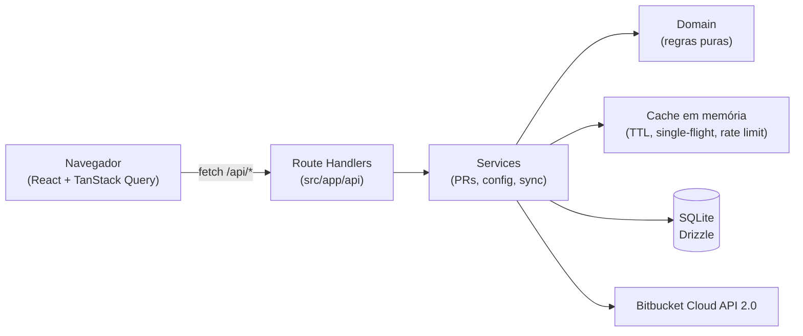
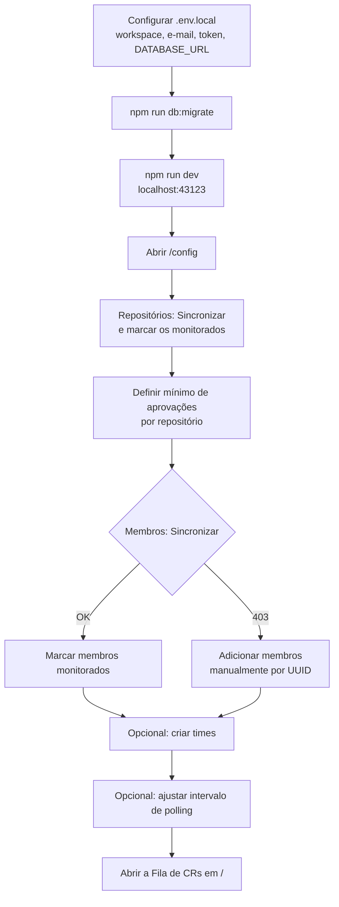
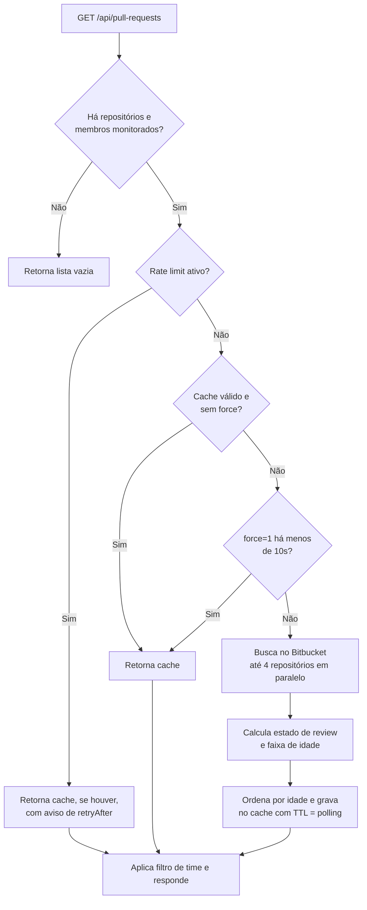

# CR Tracker — Visão geral do sistema

O **CR Tracker** é uma aplicação web **local** que centraliza os Pull Requests (code reviews) **abertos** no Bitbucket Cloud. Ele mostra uma fila única, ordenada do PR mais antigo para o mais novo, apenas com os PRs dos **membros** e **repositórios** que o usuário decidiu monitorar. O objetivo é responder rápido a perguntas como "quais PRs estão parados há mais de um dia?" e "o que já está aprovado e pronto para merge?".

Este documento descreve a arquitetura, as funcionalidades, os fluxos principais e o design de interface.

---

## 1. Stack e arquitetura

| Camada | Tecnologia |
| --- | --- |
| Framework | Next.js 16 (App Router) + React 19 |
| Dados no cliente | TanStack Query (cache, polling, mutações otimistas) |
| Tabelas | TanStack Table + ReUI Data Grid |
| UI | shadcn/ui (estilo `base-nova`, sobre Base UI) + componentes do registry ReUI |
| Estilo | Tailwind CSS v4 com tokens em OKLCH |
| Banco | SQLite local via Drizzle ORM (`better-sqlite3`) |
| Validação | Zod (respostas do Bitbucket, payloads da API e respostas no cliente) |
| Testes | Vitest |

### Camadas do código

```
src/
├── app/            Rotas (páginas "/" e "/config") e Route Handlers em app/api/*
├── components/     UI: telas (pull-requests, config), shell (sidebar, header, ⌘K) e primitivos (ui, reui)
├── hooks/          Hooks de dados (TanStack Query) e utilitários (useNow, useMobile)
├── services/       Orquestração no servidor (PRs, configuração, sincronização)
├── domain/         Regras de negócio puras e testadas (estado de review, faixa de idade, filtro por time)
└── lib/            Cliente Bitbucket, cache em memória, contador de requests, banco e schema
```

O ponto central de segurança: **o token do Bitbucket nunca chega ao navegador**. Toda chamada ao Bitbucket passa pelos Route Handlers do Next.js, que usam autenticação HTTP Basic (`BITBUCKET_EMAIL` + `BITBUCKET_API_TOKEN`) lida das variáveis de ambiente.



---

## 2. Modelo de dados

O banco SQLite guarda apenas a **configuração** do que monitorar. Os PRs em si não são persistidos: vêm do Bitbucket e ficam num cache em memória.

| Tabela | Conteúdo |
| --- | --- |
| `repositories` | Repositórios do workspace: `uuid`, `slug`, `name`, `monitored`, `min_approvals` (padrão 1), `synced_at` |
| `members` | Membros: `uuid`, `nickname`, `display_name`, `avatar_url`, `monitored`, `source` (`workspace` ou `manual`) |
| `teams` | Times: `id`, `name` (único), `created_at` |
| `team_members` | Relação N:N entre times e membros (cascade on delete) |
| `team_repositories` | Relação N:N entre times e repositórios (cascade on delete) |
| `settings` | Linha única com `poll_interval_seconds` (30, 60 ou 120; padrão 30) |

---

## 3. Funcionalidades

### 3.1 Fila de CRs (`/`)

É a tela principal. Mostra todos os PRs abertos que satisfazem duas condições: o autor é um **membro monitorado** e o PR está num **repositório monitorado**.

- **Indicadores no topo**: total de PRs abertos no filtro atual, quantos passaram de 24h ("precisam de atenção"), quantos passaram de 72h ("críticos") e quantos estão aprovados ("prontos para merge"). Os números ganham cor (amarelo, vermelho, verde) só quando são maiores que zero.
- **Tabela de PRs** com as colunas:
  - **Idade**: bolinha colorida + tempo relativo ("há 3 dias") que se atualiza a cada segundo, e um selo `>24h` ou `>72h` quando aplicável. Passar o mouse mostra a data absoluta.
  - **Pull request**: título com link para o Bitbucket (abre em nova aba) e, abaixo, `slug-do-repo #id` em fonte mono.
  - **Autor**: avatar (ou iniciais) e nome.
  - **Aprovações**: medidor segmentado com um segmento por aprovação exigida, mais o texto `aprovadas/exigidas`.
  - **Estado**: selo "Aguardando", "Em revisão", "Mudanças pedidas" ou "Aprovado".
- **Ordenação** por qualquer coluna; o padrão é por idade, do mais antigo para o mais novo. A ordenação por estado segue a prioridade: mudanças pedidas → aguardando → em revisão → aprovado.
- **Filtro por time** (select "Todos os times" ou um time específico).
- **Filtros avançados** (ReUI Filters) por **repositório** e **autor**, com operadores "é", "não é", "é qualquer de" e "não é nenhum de", combináveis com E/OU.
- **Paginação** de 50 em 50, exibida só quando há mais de 50 PRs.
- **Atualização automática** no intervalo configurado, pausada quando a aba do navegador não está visível.
- **Botão "Atualizar"** que força uma nova busca no Bitbucket (limitada a uma vez a cada 10 segundos no servidor).
- **Avisos contextuais**: configuração incompleta (nenhum repositório monitorado), limite de requisições do Bitbucket atingido (com contagem regressiva) e falhas por repositório (lista dos slugs e status HTTP).
- **Estados vazios** distintos para "nenhum repositório monitorado" (com botão para a Configuração), "nenhum PR neste filtro" e "fila zerada".

### 3.2 Regras de negócio dos PRs

Ficam em `src/domain/pull-request.ts` e são cobertas por testes unitários.

**Faixa de idade** (a partir da data de criação do PR):

| Faixa | Condição | Visual |
| --- | --- | --- |
| `normal` | menos de 24h | bolinha cinza |
| `warning` | de 24h a 72h | bolinha amarela + selo `>24h` |
| `critical` | mais de 72h | bolinha vermelha + selo `>72h` |

**Estado de review**, avaliado nesta ordem de prioridade:

1. **Mudanças pedidas**: algum participante marcou "changes requested".
2. **Aprovado**: o número de aprovações atingiu o mínimo configurado para o repositório.
3. **Em revisão**: alguém além do autor já aprovou ou interagiu como revisor.
4. **Aguardando**: nenhuma atividade de review ainda.

Aprovações do próprio autor **não contam**.

**Escopo de um time**: um PR entra no filtro de um time quando o autor é membro do time **e** o repositório está no escopo do time. Se o time não tem repositórios selecionados, o escopo é "todos os repositórios monitorados".

### 3.3 Configuração (`/config`)

Organizada em quatro abas. Cada aba mostra no título a contagem do que está monitorado.

**Repositórios**
- Botão **Sincronizar** importa (ou atualiza) a lista de repositórios do workspace a partir do Bitbucket. A sincronização preserva o que já estava marcado como monitorado e o mínimo de aprovações.
- Tabela com checkbox **Monitorar**, nome e slug, e campo **Mín. aprovações** (0 a 20, editável só para repositórios monitorados; salva ao sair do campo ou com Enter, e Esc descarta).
- Busca local por nome ou slug.

**Membros**
- Botão **Sincronizar** importa os membros do workspace.
- Se o token não tiver permissão para listar membros (HTTP 403), aparece um aviso e o usuário pode **adicionar manualmente** por UUID (com nickname opcional). Membros manuais já entram como monitorados e recebem o selo "Manual"; os importados recebem "Workspace".
- Tabela com checkbox **Monitorar**, avatar, nome, `@nickname` e UUID.
- Busca local por nome, nickname ou UUID.

**Times**
- Lista de times mostrando nome, membros, quantidade de membros e quantidade de repositórios (ou "Todos os repos").
- Botão **Novo time** e clique numa linha para editar, ambos abrindo um diálogo com nome, lista de membros monitorados e lista de repositórios monitorados (vazio significa todos).
- Exclusão com diálogo de confirmação.

**Atualização**
- Escolha do intervalo de polling: **30s, 60s ou 120s**. O mesmo valor define o tempo de vida do cache no servidor.
- Contador de **requisições ao Bitbucket na última hora** (janela deslizante em memória, zerada quando o servidor reinicia).
- Indicador de **rate limit ativo** com o tempo até a próxima tentativa.

### 3.4 Recursos globais

- **Status do token** no rodapé da sidebar: bolinha verde ("Token válido"), amarela ("Rate limit · Ns"), vermelha ("Token inválido") ou cinza ("Verificando token…"), e o total de requisições por hora. Atualiza a cada 10 segundos.
- **Paleta de comandos** (`⌘K` / `Ctrl+K`): navegar entre as telas, recarregar a fila de PRs e trocar o tema.
- **Atalhos de teclado** no estilo "G e depois letra": `G F` vai para a Fila de CRs e `G C` vai para a Configuração. Os atalhos são ignorados enquanto o foco está num campo de texto.
- **Tema** escuro (padrão), claro ou do sistema, pelo menu no header ou pela paleta.
- **Notificações (toasts)** no canto inferior direito para sucesso e erro de sincronizações e salvamentos.

---

## 4. Fluxos

### 4.1 Primeira configuração



### 4.2 Carregamento e atualização da fila

O cliente pede `GET /api/pull-requests?teamId=…` no intervalo configurado. O servidor decide entre devolver o cache ou consultar o Bitbucket:



Detalhes que tornam esse fluxo econômico em chamadas à API:

- **Uma chave de cache por conjunto de repositórios + membros monitorados**. O filtro de time é aplicado depois, sobre o resultado em cache, então trocar de time não gera novas chamadas ao Bitbucket.
- **Single-flight**: se várias abas pedem a mesma fila ao mesmo tempo, só uma busca real acontece.
- **Consulta filtrada no Bitbucket**: a busca já pede apenas `state="OPEN"` dos autores monitorados, em lotes de 25 UUIDs, com paginação limitada a 20 páginas e somente os campos necessários.
- **Retentativas**: erros 429 e 5xx são repetidos até 3 vezes com backoff exponencial (1s, 2s, 4s), respeitando o cabeçalho `Retry-After`. Cada chamada tem timeout de 10 segundos.
- **Falha parcial**: se um repositório falhar, os demais continuam e a UI lista quais falharam.
- **Invalidação**: qualquer alteração de configuração (monitorar, mínimo de aprovações, times, intervalo, sincronizações) limpa o cache, então a próxima busca já reflete a mudança.

### 4.3 Alterações na configuração

Marcar ou desmarcar um repositório ou membro, mudar o mínimo de aprovações e trocar o intervalo de polling usam **atualização otimista**: a interface muda na hora, a requisição vai ao servidor e, em caso de erro, o valor anterior é restaurado e um toast explica a falha. Ao final, a fila de PRs é invalidada para refletir a nova configuração.

### 4.4 Tratamento de rate limit

Quando o Bitbucket responde 429, o servidor registra até quando deve esperar. Nesse período, a fila é servida do cache e a UI mostra o aviso "Limite da API do Bitbucket atingido" com o tempo restante, tanto na fila quanto no rodapé da sidebar e na aba Atualização.

---

## 5. API interna

Todas as rotas ficam em `src/app/api` e respondem JSON. Erros seguem o formato `{ error: { code, message } }`.

| Método | Rota | Função |
| --- | --- | --- |
| GET | `/api/pull-requests?teamId=&force=` | Fila de PRs (com cache, filtro de time e refresh forçado) |
| GET | `/api/status` | Validade do token, requisições na última hora e rate limit |
| GET | `/api/config/repositories` | Lista repositórios |
| PATCH | `/api/config/repositories/[uuid]` | Altera `monitored` e/ou `minApprovals` |
| GET / POST | `/api/config/members` | Lista membros / adiciona membro manual |
| PATCH / DELETE | `/api/config/members/[uuid]` | Altera `monitored` / remove membro |
| GET / POST | `/api/config/teams` | Lista / cria time |
| PUT / DELETE | `/api/config/teams/[id]` | Atualiza / exclui time |
| GET / PUT | `/api/config/settings` | Lê / altera intervalo de polling |
| POST | `/api/bitbucket/repositories/sync` | Importa repositórios do workspace |
| POST | `/api/bitbucket/members/sync` | Importa membros do workspace (retorna `forbidden` em 403) |

---

## 6. Design de interface

### 6.1 Princípios

A interface segue a linha de **ferramenta de trabalho densa e silenciosa**, parecida com Linear ou Vercel: muita informação por tela, pouca decoração, e cor usada apenas para comunicar estado. O vermelho, o amarelo e o verde só aparecem quando há algo que merece atenção, como um PR crítico ou um número de aprovados maior que zero.

### 6.2 Estrutura de layout

```
┌────────────┬──────────────────────────────────────────────────────┐
│ [CR]       │ ☰ │ Workspace / Fila de CRs     [Buscar comandos ⌘K] ◐│  ← header fixo (48px)
│ CR Tracker │──────────────────────────────────────────────────────│
│            │  Fila de CRs                          Atualizado há… │
│ 🔍 Buscar  │  descrição                               [Atualizar] │
│            │                                                      │
│ WORKSPACE  │  ┌ Abertos ┬ >24h ┬ >72h ┬ Aprovados ┐                │  ← indicadores
│ ▸ Fila     │  └─────────┴──────┴──────┴───────────┘                │
│ ▸ Config.  │  [Time ▾] [Filtros…]                                 │
│            │  ┌──────────────────────────────────────────────┐    │  ← data grid denso
│            │  │ Idade │ Pull request │ Autor │ Aprov. │ Estado│    │
│ ● Token ok │  └──────────────────────────────────────────────┘    │
└────────────┴──────────────────────────────────────────────────────┘
```

- **Sidebar** recolhível para modo só-ícones (com tooltips), estado salvo em cookie e transformada em gaveta no mobile. Contém a marca, o atalho de busca, a navegação e o status do token.
- **Header** fixo com botão da sidebar, breadcrumb ("Workspace / página atual"), busca de comandos e seletor de tema.
- **Conteúdo** centralizado com largura máxima de `max-w-7xl` e espaçamento interno de 16px no mobile e 32px no desktop.
- Cada página começa com um **PageHeader** padrão: título, descrição curta e ações alinhadas à direita.

### 6.3 Cores

Os tokens ficam em `src/app/globals.css`, definidos em **OKLCH** para os temas claro e escuro. A base é **neutra (cinza sem matiz)** e há um único tom de destaque azul-índigo (matiz 264).

| Token | Papel | Uso típico |
| --- | --- | --- |
| `primary` | Índigo | Ações principais, foco, logotipo, aprovações parciais |
| `success` | Verde | Estado "Aprovado", medidor completo, token válido |
| `warning` | Âmbar | PR acima de 24h, rate limit, aviso de 403 |
| `destructive` | Vermelho | PR acima de 72h, "Mudanças pedidas", erros, exclusões |
| `info` | Índigo | Estado "Em revisão" |
| `muted` / `secondary` | Cinzas | Textos secundários, estado "Aguardando", fundos de selos |

Cada cor semântica tem uma variante `-foreground` para texto, ajustada separadamente em cada tema para manter contraste. O tema **escuro é o padrão**.

**Superfícies e bordas.** Há três níveis de superfície: `background` (fundo da página) < `card` (cartões, tabelas, indicadores) < `popover` (elevado: popovers, menus, selects, diálogos, paleta e toasts). No tema escuro a elevação é feita só por luminosidade (0.12 → 0.16 → 0.20), sem sombras; no claro o fundo é 0.985 e cartões e popovers são brancos, com sombra leve nos elevados. As bordas usam um único token translúcido, `border` (10% de preto no claro e 10% de branco no escuro), inclusive nos anéis de popovers, diálogos e cartões (`ring-border`) e na sidebar. Separadores internos mais leves usam `border-border/60`.

### 6.4 Tipografia

- **Geist Sans** para a interface e **Geist Mono** para dados técnicos.
- A fonte mono com `tabular-nums` é usada de forma sistemática em números e identificadores: contadores, idades, `aprovadas/exigidas`, slugs, UUIDs, intervalos (`30s`) e atalhos. Isso mantém os números alinhados e evita que a tabela "pule" quando os valores mudam.
- Hierarquia enxuta: título de página `text-2xl` em negrito, textos de apoio `text-sm`/`text-xs` em `muted-foreground`.

### 6.5 Forma e espaçamento

- Raio base de **0,75rem**, com escala de `sm` (0,5rem) a `4xl` (2rem).
- Superfícies agrupadas como cartões com borda fina e fundo `card` (`rounded-lg border bg-card`), sem sombras pesadas.
- **Header** com fundo translúcido e `backdrop-blur` quando a página é rolada; a borda inferior só aparece depois que o conteúdo sai do topo.
- **Linhas da fila**: hover com fundo sutil (transição de 120ms); PRs acima de 72h ganham uma borda esquerda de 2px em `destructive`, sem tingir a linha.
- **Botões** primário, secundário e outline encolhem para `scale(0.98)` ao serem pressionados.
- Tabelas em modo **denso**, com bordas entre linhas, cabeçalho com fundo próprio e fixo no topo durante a rolagem da fila.
- Ícones Lucide em tamanho pequeno, sempre acompanhando um rótulo de texto nas ações.

### 6.6 Componentes visuais próprios

- **Indicador de idade**: bolinha de 8px cuja cor resume a faixa de idade, ao lado do tempo relativo.
- **Medidor de aprovações**: barra segmentada (um segmento por aprovação exigida). Os segmentos preenchidos ficam índigo enquanto o mínimo não é atingido e ficam todos verdes quando é.
- **Selos de estado**: `Badge` com variantes semânticas (secondary, info, destructive, success).
- **Faixa de indicadores**: grade de 2 colunas no mobile e 4 no desktop, separada por bordas internas, com esqueletos durante o carregamento.
- **Link do PR**: o título ganha cor primária ao passar o mouse e revela uma seta ↗ (que desliza 2px ao aparecer) indicando que abre fora do app.

### 6.7 Estados e feedback

- **Carregamento**: esqueletos estáticos (sem pulso) nos indicadores, na tabela e na lista de times, com a altura exata do conteúdo real (linhas da fila de 51px); ícone de atualizar gira enquanto a requisição está em andamento; barra de progresso de 2px sob o header enquanto a fila é buscada.
- **Vazio**: componente `Empty` com ícone, título, explicação e, quando faz sentido, um botão de ação.
- **Erros e avisos**: `Alert` nas variantes `warning` e `destructive`, sempre com título curto e descrição acionável.
- **Ações**: toasts de sucesso com números ("12 repositórios sincronizados (3 novos, 9 atualizados)") e de erro com mensagem padrão em português.
- **Ações destrutivas**: excluir um time exige confirmação num `AlertDialog`.

### 6.8 Responsividade

- Sidebar vira gaveta no mobile e fecha automaticamente ao navegar.
- O botão de busca do header vira um ícone em telas pequenas.
- Barras de ferramentas e formulários empilham verticalmente no mobile e ficam em linha a partir de `sm`.
- O texto "Atualizado há… · a cada Ns" é escondido em telas pequenas para priorizar o botão de atualizar.

### 6.9 Acessibilidade

- Documento em `lang="pt-BR"` e toda a interface em português, incluindo os textos internos do data grid e dos filtros.
- O medidor de aprovações usa `role="meter"` com `aria-valuenow`, `aria-valuemax` e um rótulo como "1 de 2 aprovações".
- O status do token é anunciado por leitores de tela (`role="status"` com `aria-live="polite"`).
- Checkboxes, campos numéricos e selects têm `aria-label` descritivo, como "Monitorar nome-do-repo".
- Datas usam `<time dateTime>` com a data absoluta no `title`.
- Foco visível com um único anel em todos os elementos interativos: utilitário `focus-ring` (outline de 2px na cor `ring`, offset de 2px). Links soltos herdam o mesmo anel pela camada base; linhas clicáveis que ocupam toda a largura de um contêiner usam o mesmo anel com offset para dentro.
- Ícones decorativos são ocultados com `aria-hidden`.
- Com `prefers-reduced-motion`, nada se desloca nem muda de escala (ver 6.10).

### 6.10 Movimento

O movimento segue a mesma regra da cor: existe para comunicar mudança de estado, não para decorar. Só se animam `transform` e `opacity` (e `background-color` em destaques pontuais); a única exceção é a largura da sidebar ao recolher.

**Tokens** (em `src/app/globals.css`, espelhados em `src/components/motion/tokens.ts` para o Motion):

| Token | Valor | Uso |
| --- | --- | --- |
| `--duration-fast` | 120ms | Hover, realce da paleta, saídas de diálogos |
| `--duration-base` | 200ms | Entradas, crossfades, troca de tema, sidebar |
| `--duration-slow` | 320ms | Layout animation, rolagem dos números, desenho do check |
| `--ease-out` | `cubic-bezier(0.23, 1, 0.32, 1)` | Entradas e mudanças que partem do repouso |
| `--ease-in-out` | `cubic-bezier(0.77, 0, 0.175, 1)` | Elementos que se movem ou mudam de tamanho na tela |

Em CSS use os utilitários `duration-fast`, `duration-base` e `duration-slow` (também valem para o `tw-animate-css`) e `ease-out`/`ease-in-out`. Animações com estado usam o Motion (`motion/react`); o resto usa CSS.

**Padrões**:

- **Atualização da fila**: barra de progresso indeterminada de 2px em `primary`, que só aparece se a busca passar de 300ms. PRs novos entram com fade + 6px e um brilho em `primary` que some em 1,5s (nunca na carga inicial nem na troca de time). PRs que saem fazem fade-out antes de serem removidos. Reordenações usam layout animation, só na página visível. Linhas são memoizadas pelo objeto do PR: um poll sem mudanças não re-renderiza nenhuma.
- **Indicadores**: números rolam com NumberFlow; ao sair de 0, o indicador com tom recebe a cor com transição e um único pulso.
- **Skeleton → conteúdo**: crossfade de 200ms sem salto de layout.
- **Medidor de aprovações**: segmentos preenchem com escala/opacidade, 30ms entre eles; ao atingir o mínimo, todos passam a `success` juntos.
- **Selos de estado**: crossfade com scale 0.96 → 1 quando o estado muda.
- **Navegação**: `<ViewTransition>` do React em cada página faz crossfade de 150ms entre rotas. A sidebar recolhe com transição de largura e fade dos rótulos. Diálogos e a paleta ⌘K entram com scale 0.98 → 1 + fade; o realce do item ativo da paleta e o indicador das abas de `/config` deslizam via `layoutId`.
- **Tema**: crossfade de 200ms com a View Transitions API; sem suporte, a troca é instantânea.
- **Estados vazios**: "Fila zerada" desenha o check uma vez; os demais só fazem fade.

**Restrições**: nenhum loop infinito além dos spinners de requisição e da barra de progresso; sem bounce nem entrada escalonada da tabela na carga inicial.

**Movimento reduzido**: `MotionConfig reducedMotion="user"` na raiz remove transforms e layout animations do Motion e mantém os fades; animações e transições CSS ficam instantâneas; a barra de progresso vira uma faixa estática; os crossfades de rota e de tema continuam.

---

## 7. Observações e limites atuais

- O cache, o contador de requisições e o estado de rate limit vivem **em memória** no processo do servidor. Reiniciar o servidor zera tudo isso, mas não a configuração, que fica no SQLite.
- O app foi pensado para **uso local por uma pessoa**. Não há autenticação de usuários; quem acessa a porta `43123` tem acesso total à configuração.
- O endpoint `/api/status` consulta o Bitbucket (`/user`) a cada 10 segundos por aba aberta, sem cache. Isso entra na contagem de requisições por hora e pode ser relevante se houver muitas abas abertas.
- A trava de "Atualizar" (uma vez a cada 10 segundos) vale por conjunto de repositórios e membros monitorados, e não por time ou filtro.
